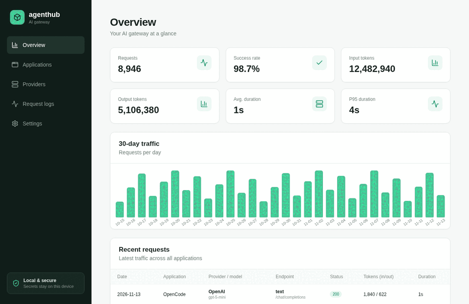
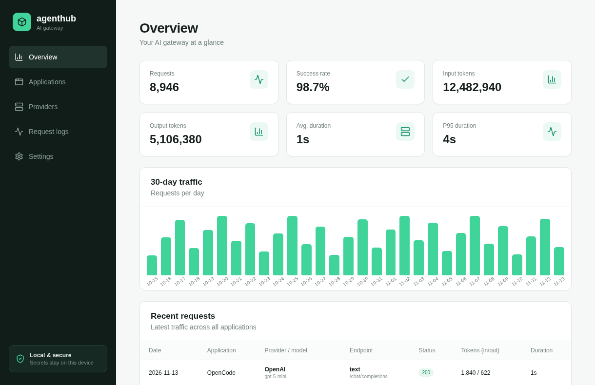
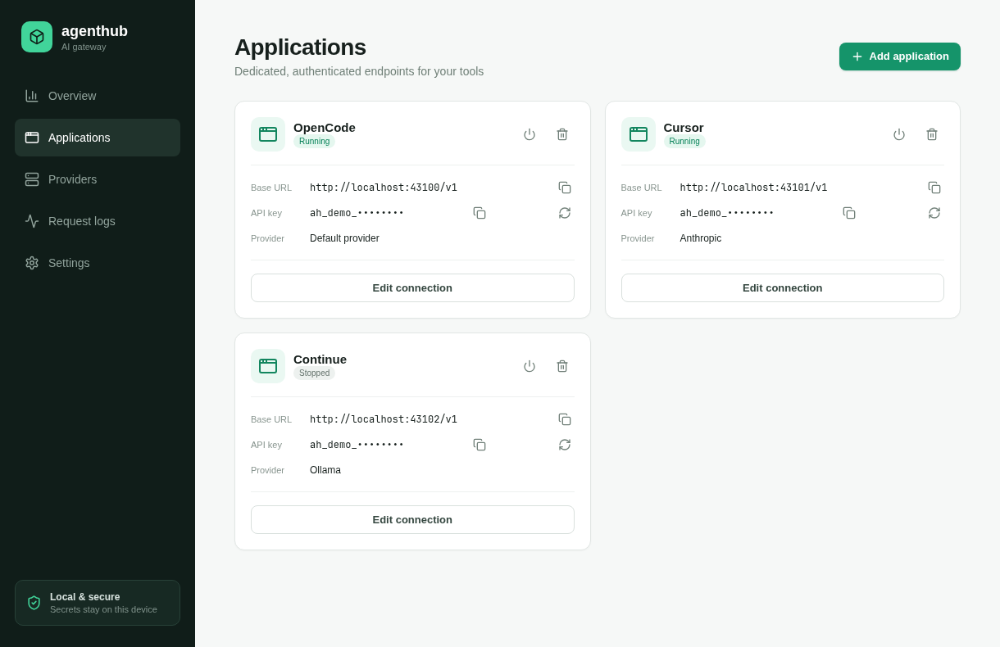
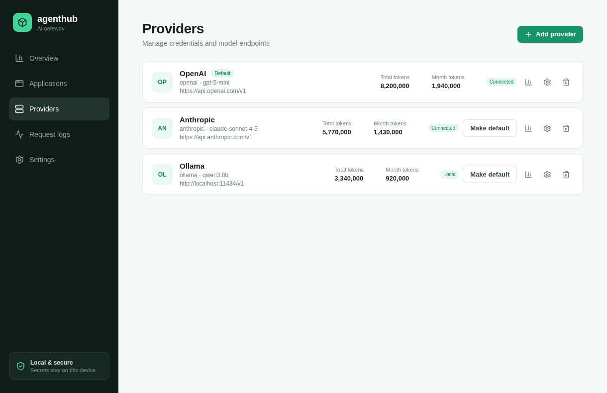
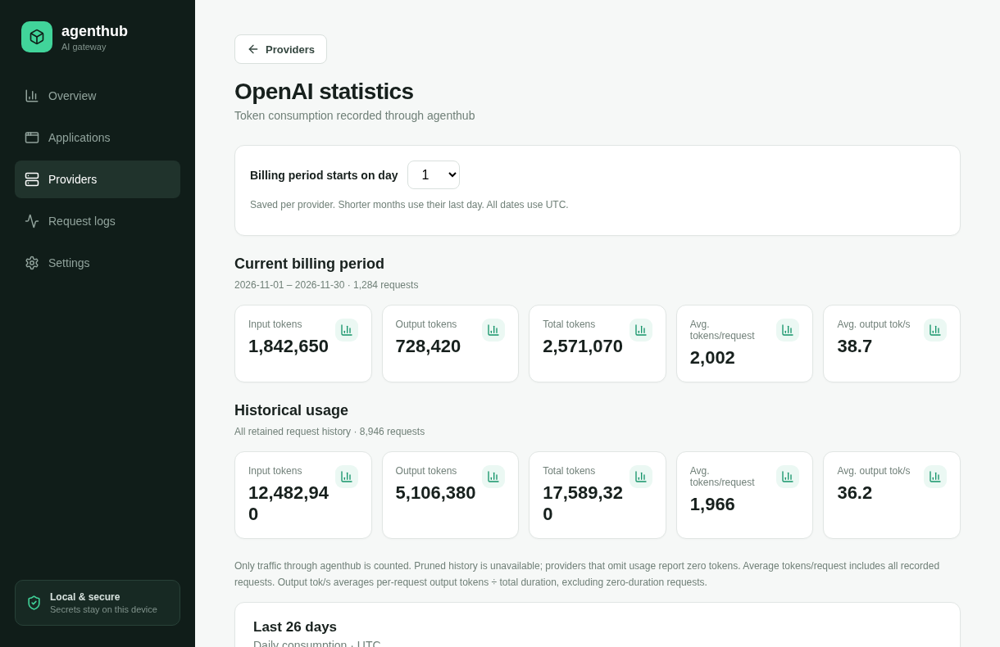
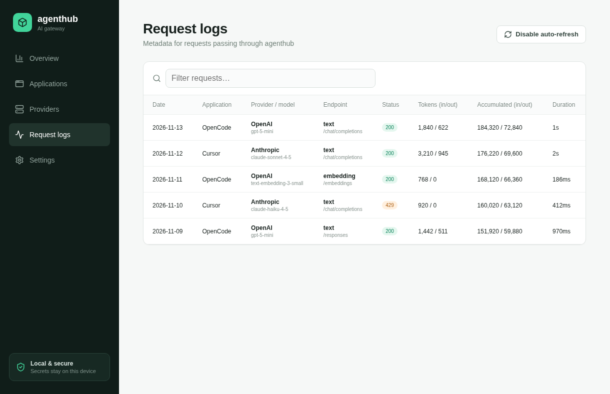
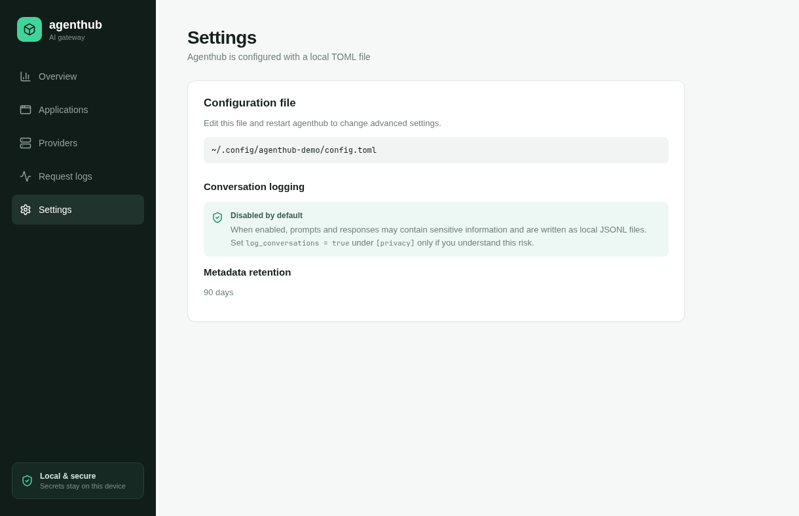

# agenthub

Agenthub is a Tauri desktop gateway that gives local applications isolated,
OpenAI-compatible endpoints while keeping provider credentials in one place.

**[Website and documentation](https://merlos.github.io/agenthub/)**



## Development

Requirements: Node.js 20+, Rust stable, and the [Tauri 2 system
dependencies](https://v2.tauri.app/start/prerequisites/).

```bash
npm install
npm run tauri dev
```

For frontend-only development, run `npm run dev`. Build with `npm run build`
and run tests with `npm test`.

The Astro marketing site and Starlight documentation live in `website/`. Run
`npm install --prefix website` once, then use `npm run website:dev` or
`npm run website:build` from the repository root.

### Marketing demo

Run `npm run demo` to serve a browser-only version populated with realistic fake
providers, applications, traffic, request logs, and usage statistics. It is
intended for screenshots and video recordings and supports in-memory UI edits.
The demo does not invoke Tauri, access the keyring or database, contact provider
APIs, or start local proxy listeners. All changes disappear when the page is
reloaded, and every displayed credential is deliberately fake.

Useful capture routes include `/`, `/applications`, `/providers`,
`/providers/demo-openai/stats`, `/logs`, and `/settings`. Use a `1220×790`
viewport to match the default desktop window. When adding or changing a
UI-visible feature, data contract, or workflow, update `src/demoApi.ts` so the
demo remains representative.

Generate the README screenshots and animated slideshow with Playwright and
ImageMagick:

```bash
npm run screenshots:install # first run only
npm run screenshots:all
```

The command starts the demo server automatically, writes the individual PNGs
to `docs/assets/`, and creates `docs/assets/agenthub-demo.gif`. ImageMagick's
`magick` command must be available to build the GIF.

<details>
<summary>View full-quality screenshots</summary>

| Overview | Applications |
| --- | --- |
| [](docs/assets/overview.png) | [](docs/assets/applications.png) |

| Providers | Provider statistics |
| --- | --- |
| [](docs/assets/providers.png) | [](docs/assets/openai-statistics.png) |

| Request logs | Settings |
| --- | --- |
| [](docs/assets/request-logs.png) | [](docs/assets/settings.png) |

</details>

## Connecting a client

1. Add a provider, then add an application in agenthub.
2. Copy the application's base URL and generated key.
3. Configure the client as an OpenAI-compatible service. For example:

```text
OPENAI_BASE_URL=http://localhost:43100/v1
OPENAI_API_KEY=ah_...
```

Every application has its own port and key. Provider keys are stored in the
operating system keyring and are never returned to the frontend.

Advanced settings are in `~/.config/agenthub/config.toml` on Linux (the
platform configuration directory is used on macOS and Windows).

## Advanced configuration

Agenthub creates this file on first launch. Edit it and restart Agenthub:

```toml
[server]
bind = "127.0.0.1"
port_start = 43100
port_end = 43999
# Maximum time to wait for a provider response, in seconds.
# Increase this for slow local models. Default: 1800 (30 minutes).
request_timeout_seconds = 1800

[privacy]
log_conversations = false
# conversation_log_directory = "/path/to/logs"
conversation_retention_days = 30
conversation_max_file_mb = 10

[retention]
# Zero retains request metadata indefinitely.
request_metadata_days = 0
```

Conversation logs can contain sensitive prompts and responses. They are
disabled by default and, when enabled, are stored as rotated JSONL files rather
than in the Agenthub database.

## Supported endpoints

Agenthub exposes models, chat completions, legacy completions, responses,
embeddings, image generation/editing/variations, and audio speech,
transcription, and translation routes. A route works when the selected provider
and model support that modality. See [`APP.md`](APP.md) for the detailed support
and limitation matrix.
